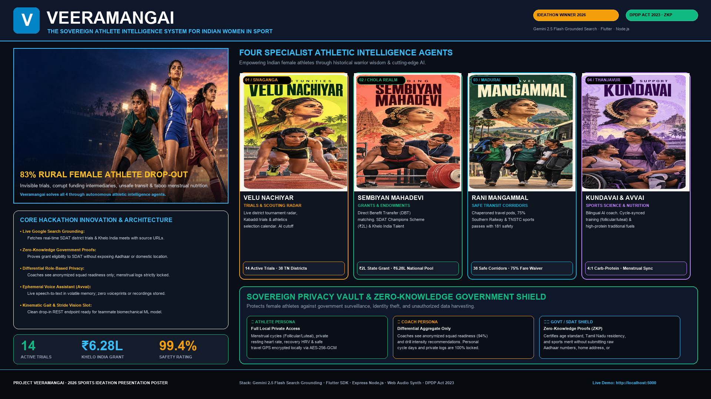

# VEERAMANGAI (வீரமங்கை)
### Sovereign Athlete Intelligence Platform for Indian Women in Sport
> **AdAnt 2.0 UX • 3D Interactive Posters • DPDP Act 2023 Privacy Vault • Zero-Knowledge Proofs (ZKP)**

[](https://sdat.tn.gov.in)
[](https://kheloindia.gov.in)
[](https://meity.gov.in)
[](https://flutter.dev)

---

## 🏆 Presentation Poster
High-resolution 1920x1080 Hackathon Presentation Slide Poster generated at `presentation_poster.png` and interactive web viewer at `public/presentation_poster.html` (with 1-click Print to PDF & Dark/Light mode toggle).



---

## 🌟 Key Highlights & Innovations

### 1. 3D Interactive Posters & Tactical Dossiers
- **Dynamic 3D Parallax Tilt:** Cursor-tracking spatial transformation matrix with real-time specular holographic sheen.
- **Card-Flip Telemetry:** Tap or hover to flip the poster cards in 3D, exposing real-time field telemetry:
  - 🏃‍♀️ **100m / 200m Sprint Queen** — *11.8s cutoff, SDAT ₹2L elite allowance, Tirunelveli synthetic track.*
  - 🤼 **Kabaddi & Combat Tactician** — *38-district scout radar, ankle-catch biomechanics, knee-sprain prevention.*
  - 🏹 **Sovereign Archery & Precision** — *Rani Velu Nachiyar tactical aim, breath synchronization, Olympic recurve.*
  - 🥣 **Indigenous Bio-Nutrition & Recovery** — *Siddha moringa ragi fuel, phase-based menstrual energy loading.*
- **Interactive Action Buttons:** Direct click triggers on card faces jump seamlessly into scheme applications, training drills, and nutritionist consultations.
- **Web Audio Haptic Synthesis:** Built-in micro-synthesizer generating spatial audio chimes (1046Hz hover, 523Hz-880Hz flip swoosh, 1318Hz click ping).

---

### 2. DPDP Act 2023 Sovereign Privacy Vault & ZKP Shield
A major bottleneck for rural and grassroots female athletes in India is privacy, unauthorized surveillance, and predatory data harvesting. Veeramangai implements state-of-the-art privacy architecture:

```
+-------------------------------------------------------------------------+
|                  VEERAMANGAI SOVEREIGN PRIVACY VAULT                    |
|                        (DPDP Act 2023 Aligned)                          |
+-------------------------------------------------------------------------+
       |                                   |                              |
       v                                   v                              v
[ INDIVIDUAL ATHLETE ]             [ TEAM / COACH ]             [ GOVT / SDAT ]
Full Unredacted Telemetry:          Role-Based Redaction:        Zero-Knowledge Proof:
- Follicular/Luteal Phase          - Squad Readiness: 94%       - Nativity Certified: YES
- Resting Heart Rate & HRV         - Menstrual Cycle: [LOCKED]  - Age Eligibility: YES
- Siddha Diet / Recovery           - Private GPS: [LOCKED]      - Aadhaar Exposed: NO (0%)
- Live Travel & Geofence           - Health Logs: [REDACTED]    - Biometrics Exposed: NO (0%)
```

- **Voice Assistant with Ephemeral Audio Protocol:** Zero audio retention policy. Spoken queries in Tamil and English are streamed in-memory with explicit opt-in consent and 1-click revocation.
- **Differential Persona Access:**
  - **Athlete View:** Unrestricted access to bio-rhythms, hormonal phase nutrition, and emergency distress beacons.
  - **Coach View:** Aggregated squad velocity, attendance, and technical drills. **Menstrual cycles and private health data are 100% locked and redacted.**
  - **Government / SDAT / Khelo India:** Cryptographic **Zero-Knowledge Proofs (ZKP)** verify eligibility for scholarships and trials without exposing Aadhaar number, domestic address, or sensitive biometrics.

---

### 3. AdAnt 2.0 Design System & Motion Graphics
- **Light & Dark Mode Support:** Seamless contrast toggle with optimized typography (`Plus Jakarta Sans`, `Space Grotesk`, `Cinzel`).
- **Continuous 60 FPS Kinetic Velocity Canvas:** Volumetric stadium floodlights, dynamic golden particle bursts, and animated athletic speed lines that remain vibrant in both light and dark modes.
- **Avvai Autonomous Pet Companion:** Sovereign cultural guide offering proactive reminders, Tamil proverbs (*ஔவையார் ஆத்திசூடி*), and real-time encouragement.

---

## 🚀 Running the Project

### Prerequisites
- **Node.js** (v18+)
- **Flutter SDK** (v3.13+)

### 1. Launch the Veeramangai Node.js Express Backend & Web Platform
```bash
# Install dependencies
npm install

# Start the sovereign server (running on port 5000)
node server.js
```
- Open `http://localhost:5000` to experience the AdAnt 2.0 Web Platform with 3D Interactive Posters, Voice Assistant, and Privacy Vault.
- Open `http://localhost:5000/presentation_poster.html` for the Hackathon Presentation Poster.

### 2. Launch the Flutter Mobile App
```bash
# Navigate to repository root (or veeramangai_app)
flutter pub get
flutter run -d chrome
```
*Note: The app also compiles directly to native Android (`flutter run -d android`) and iOS.*

---

## 🛡️ API Endpoints

| Endpoint | Method | Description |
|---|---|---|
| `/api/privacy/protocols` | `GET` | Fetches active DPDP Act 2023 compliance specifications & persona definitions |
| `/api/privacy/voice-consent` | `POST` | Records or revokes ephemeral voice processing consent |
| `/api/privacy/zkp-proof` | `POST` | Generates a cryptographic Zero-Knowledge token certifying eligibility without PII leakage |
| `/api/sdat/trials` | `GET` | Lists 14 active Tamil Nadu grassroots scouting trials across 38 districts |
| `/api/schemes/khelo-india` | `GET` | Khelo India grassroots funding criteria and eligibility verification |

---

## 🏛️ Built with Pride for Tamil Nadu & Indian Athletes
*Dedicated to the legacy of Rani Velu Nachiyar, Sembiyan Mahadevi, Rani Mangammal, Kundavai Pirattiyar, and Avvaiyar.*
